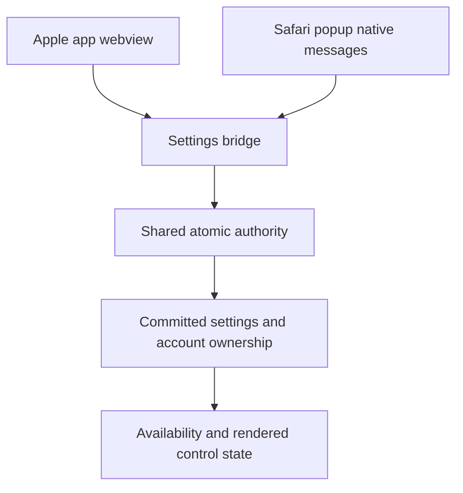
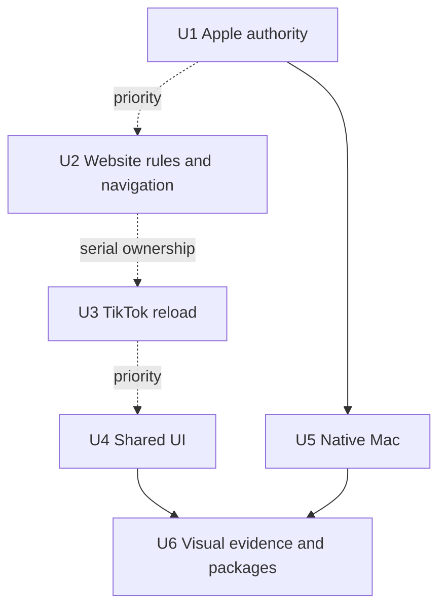

# Owner QA remediation - Plan

## Execution evidence

- U1: implemented signed-out local editing and narrow persisted-hold recovery in both writers;
  unavailable Apple switches now use the existing disabled state. The original regressions failed
  before the change. Focused checks passed 131 tests; full StillKit passed 487 tests; repository
  tests, lint, typecheck and builds passed. Browser fixtures and PR CI are the remaining merge gates.
  Completed code review found no actionable defects. Physical Mac/iPhone successor retests remain pending.
- U2–U5: implementation proceeds in isolated worktrees with exclusive file ownership.
- U6: package generation follows reviewed merges. Facebook live DOM and current visual references
  remain evidence requirements; no synthetic fixture establishes a live-site or owner pass.

## Goal Capsule

Restore responsive free controls and usable supported websites, then deliver the approved presentation corrections in a coherent sandbox test set.
The executing agent owns diagnosis, source changes, review, serial CI-green merges and build evidence; the owner retains protected environment approvals, device installation and observed retests.
`STRATEGY.md`, `docs/PRODUCT.md` and the issue-specific owner requirements govern behavior.
Missing runtime evidence blocks the affected claim or packet, not unrelated eligible work.

---

## Product Contract

### Summary

Repair the Apple settings freeze first, then the remaining website, popup and native Mac findings from 14 October.
Prepare successor packages from reviewed merged source and retain the distinction between source fixes and owner verification.

### Problem Frame

Free settings become unavailable across Apple surfaces, while blocking causes or accompanies several website failures.
Other findings concern missing or duplicate cards, offer navigation and approved layout changes.
The installed package predates some merged fixes, so sightings cannot by themselves establish regressions in newer source.

### Requirements

**Free control and website behavior**

- R1. ISS-0050: free Apple controls remain usable after fresh opening, retry, Safari relaunch, offer dismissal and controlled repeated toggles, preserving committed choices and account isolation.
- R2. ISS-0035: Facebook Home-feed Reel units and mobile Page Reels entries disappear while ordinary photos, videos, ads, Stories and Pro-only content retain their approved behavior.
- R3. ISS-0052: a shared Instagram Reel plays its first clip across same-ID aliases; a different-ID Next returns Home without a redirect loop.
- R4. ISS-0053: Instagram Explore continues loading and scrolling under free blocking on Firefox and iPhone without holes or a stalled spinner.
- R5. ISS-0054: after turning TikTok Off, an explicit same-tab reload leaves the blocked page and loads the original permitted destination without URL re-entry.

**Popup and native presentation**

- R6. ISS-0032/0051: eligible free users get a reliable Pro entry and exactly one canonical optional sync/sign-in card across popup opening and invitation states.
- R7. ISS-0041/0043: browser lock navigation starts with the offer heading visible, and Firefox Android exposes a discoverable return route within its supported navigation behavior.
- R8. ISS-0042/0047: Firefox desktop scrollbar placement remains stable on expansion; Safari Mac retains its outer height with reachable internal content through expansion and status changes.
- R9. ISS-0046: Safari Mac and iPhone app-opening captions sit below their respective buttons; the Mac action buttons have equal widths.
- R10. ISS-0044: Mac onboarding automatically refreshes Safari enabled status in both directions, including foreground return.
- R11. ISS-0045/0048: the Mac completion subtitle is exactly “Distractions are removed from enabled websites in Safari”; main settings spacing is 10–15% tighter, with Pro before sync and existing approved copy reused.
- R12. ISS-0049: every native Mac Pro lock opens the existing full offer directly; Close returns to responsive settings without starting a purchase.
- R13. ISS-0016: only deviations supported by the current approved design and current screenshots are changed or submitted for explicit owner acceptance.

**Delivery constraints**

- R14. Free blocking and sync, optional sign-in, narrow host permissions and dormant paid behavior in shipped 2.x builds retain their existing contracts; purchases remain sandbox-only.
- R15. Tests and builds establish engineering evidence only; owner passes and FIXED_VERIFIED require observed successor-package retests.

### Scope boundaries

ISS-0055 is excluded because the positive settings-match/checking message was withdrawn.
ISS-0003, ISS-0013, ISS-0027 and ISS-0028 remain owner-dependent follow-up work.
No production analytics deletion, account reset, cookie reset, settings reset, reinstall workaround, real payment, store submission, DNS change or protected workflow approval is included.
Already-merged fixes awaiting retest enter the successor package without duplicate implementation.

---

## Planning Contract

- KTD1. Diagnose before choosing a fix. Use existing behavioral tests and bounded runtime evidence to distinguish persisted native holds, transport loss, layout geometry and navigation aliasing; screenshot appearance does not prove a mechanism.
- KTD2. Preserve atomic authority and cross-language parity. Recovery must retain local choices without replaying uncertain commands or sending a previous account's held operations into another account. Follow `docs/solutions/logic-errors/treat-a-lost-settings-reply-as-unknown-and-reread.md`.
- KTD3. Own shared files serially. Refresh claims, open PRs and worktrees before each packet and before branch creation. Work from fresh `origin/main`; skip specifically owned packets. Serialize Apple bridge, popup/settings/navigation, entitlement and signed-rule edits, and merge one reviewed CI-green PR at a time.
- KTD4. Use real feed ownership and navigation identity. Follow `docs/solutions/ui-bugs/identify-a-feed-card-by-the-sites-item-wrapper.md` and `docs/solutions/logic-errors/preserve-page-state-when-classifying-navigation.md`; fixture additions must describe captured shapes or explicitly synthetic regressions.
- KTD5. Preserve evidence boundaries. Refresh each issue row immediately before updating only that row, retain fix history, and leave the QA answer files to their existing writer. Source-fixed rows become FIXED_AWAITING_RETEST with a concrete fix reference and retest IDs.

### High-Level Technical Design

### Assumptions and execution-time unknowns

The baseline source is `5f60e894`; each packet must reconcile with newer main before implementation.
A read-only Mac metadata inspection found durable `ordering-hold` with `previous-account` ownership, no account scope, sync metadata and one held operation; native rereads reject that paused authority.
The traced native and TypeScript commit paths use `anchor?.revision ?? 0` after sign-out clears the anchor while retaining clocks with a higher base revision.
Field allocation then rejects the edit as `stale-acknowledgement` and persists the ordering hold.
Signed-out local editing needs an independent ordering basis without publishing previous-account work.
The existing unknown-local allowance does not establish that previous-account state can be adopted safely.
The narrow native/TypeScript repair and held-operation handling must be proved during U1; the phone's first-tap cause remains unconfirmed.
Website DOM, redirect transitions, actual toolbar-popup motion and physical device behavior remain execution evidence, not planning facts.

---

## Implementation Units

### U1. Apple authority and responsive free controls

**Requirements:** R1, R12, R14, R15. **Dependencies:** none; first priority.

**Files:** `apps/apple/StillKit/Sources/StillKit/SettingsBridge.swift`, `apps/apple/StillKit/Sources/StillKit/SharedSettingsStore.swift`, `apps/apple/StillKit/Sources/StillKit/AtomicSettingsRecord.swift`, `packages/core/src/storage/atomic-settings.ts`, `packages/core/src/storage/cache.ts`, `packages/core/src/ui/v3/desktop-popup-binding.ts`, `packages/core/src/ui/v3/popup-view-binding.svelte.ts`, and the affected Apple host as evidence requires.
Tests: `apps/apple/StillKit/Tests/StillKitTests/AtomicSettingsLocalOnlyTests.swift`, `apps/apple/StillKit/Tests/StillKitTests/AtomicSettingsTests.swift`, `packages/core/src/storage/__tests__/atomic-settings-local-only.test.ts`, `packages/core/src/storage/__tests__/atomic-settings-writer-vectors.test.ts`, `packages/core/src/storage/__tests__/cache-authority-recovery.test.ts`, `packages/core/src/ui/v3/apple-pro-host.integration.test.ts`, `packages/core/src/ui/v3/AppleSettings.test.ts`.

**Approach:** apply KTD1–KTD2 to the common native authority path, then distinguish any remaining app-only rendering or phone startup defect. Start with failing regressions for the observed persisted hold. Repair only the recognized recoverable state through the existing atomic writer, preserving ownership, committed settings and safe held-edit semantics. Propagate `commandsDisabled` into native settings controls where required. Expose honest disabled/recovery state where a command cannot run; never hide an unsuccessful write behind an active-looking switch.

**Test scenarios:**

1. Signed-out previous-account authority with sync metadata and held state can recover local free editing through a safe ownership transition, retaining chosen values and isolating old-account operations.
2. Native and TypeScript writers agree on that transition and retain fail-closed behavior for malformed, mismatched or still-ambiguous authority. Sign-in to the same or a different account never publishes quarantined prior-account operations or silently adopts that account's settings.
3. A lost write reply triggers an authority reread without replay; delayed and superseded reads cannot strand an earlier recoverable hold or erase a newer committed choice.
4. Fresh opening, Try again and relaunch exercise persisted state; popup remount preserves the last committed value.
5. Normal/controlled fast main toggles and the first command after startup work once authority is ready; no uncertain command is silently queued for replay.
6. Offer open/Close, repeated visits, cancellation and an existing purchase-error state leave all free controls responsive and never initiate a transaction merely through navigation.

**Verification:** native tests, cross-language vectors, host tests and actual Mac app/Safari comparison establish the repaired mechanism. Physical iPhone lifecycle and successor-package owner retests remain separately required.

### U2. Website content, shared Reel navigation and Explore loading

**Requirements:** R2–R4, R14–R15. **Dependencies:** U1 is the first priority, not a requirement to finish owner retests before proceeding; exclusive serial ownership of rules/content files. Split independent issue fixes into reviewed PRs if useful.

**Files:** `packages/core/src/rules/facebook.ts`, `packages/core/src/rules/instagram.ts`, `packages/core/src/rules/engine.ts`, `packages/core/src/content/index.ts` as diagnosed.
Tests: `tests/fixtures/facebook.html`, `tests/fixtures/facebook-mobile.html`, `tests/fixtures/instagram-explore.html`, `tests/playwright/fixtures.spec.ts`, `tests/playwright/fixtures-format2.spec.ts`, `packages/core/src/rules/__tests__/facebook-format2.test.ts`, `packages/core/src/rules/__tests__/instagram-format2.test.ts`, `packages/core/src/content/__tests__/format2-navigation.test.ts`, `tests/firefox/qa-blocking-matrix.spec.ts`.

**Approach:** capture the bounded offending unit or route transitions before selecting selectors or navigation changes, per KTD1/KTD4. Preserve the virtualizer, loader sentinel, current signed-rule conventions and separate ordinary content from identified Reels.

**Test scenarios:**

1. Identified Home-feed Reels disappear on initial and later insertion; ordinary photos/videos and non-Reel ads survive without column gaps.
2. Mobile Page Reels entries hide and restore live without disturbing adjacent navigation; previous menu/route behavior survives.
3. Same-ID singular/plural and bare/www aliases preserve first-clip playback, including server/login redirects; different-ID Next returns Home without oscillation.
4. Mixed Explore photos/carousels/Reels load successive batches and keep scroll geometry in Firefox and iPhone dimensions; On/Off comparison shows live recovery and restoration.
5. Existing profile, Home and viewer navigation remain correct after each change.

**Verification:** captured-shape fixtures plus real browser evidence. Synthetic DOM or mocked navigation cannot establish a live-site fix. Retest CH-18, IOS-17/19/33 and existing ISS-0035 cases; CH-16/FX-16 for ISS-0052; FX-17/IOS-16 for ISS-0053.

### U3. TikTok same-tab Off and reload recovery

**Requirements:** R5, R14–R15. **Dependencies:** shared content ownership released; U1 availability is required for meaningful combined device retests, not isolated navigation work.

**Files:** `packages/core/src/ui/v3/tiktok-blocked-presentation.ts`, `packages/core/src/content/tiktok-blocked-navigation.ts`, `packages/ext-safari/lib/tiktok-host.ts`, `packages/ext-safari/entrypoints/tiktok-blocked/BlockedPage.svelte` as diagnosed.
Tests: `packages/core/src/content/__tests__/tiktok-blocked-navigation.test.ts`, `packages/core/src/ui/v3/TikTokBlocked.test.ts`, `packages/ext-safari/lib/tiktok-host.test.ts`, `packages/ext-safari/entrypoints/tiktok-blocked/__tests__/safari-tiktok-blocked.test.ts`, `tests/playwright/safari-tiktok-blocked.spec.ts`.

**Approach:** characterize navigation and current authoritative settings when the blocked document reloads; separate document restoration from settings authority failure. Use the existing destination-validation path.

**Test scenarios:**

1. On blocks, Off commits, and explicit reload in the same tab resumes the validated original TikTok URL without bypass allowance or re-entry.
2. Main Off follows the same permitted recovery while On continues blocking.
3. Stale replies, restored blocked documents and unavailable authority do not invent successful setting changes or unsafe destinations.
4. Existing allowance and desktop/mobile guidance remain correct.

**Verification:** host/navigation tests and actual Safari iPhone Off/reload sequence; IOS-28 owner verification remains pending until a successor package is installed.

### U4. Shared popup cards, offer arrival and scroll layout

**Requirements:** R6–R9, R14–R15. **Dependencies:** shared popup/settings/navigation ownership released; U1 and U3 take priority when executable.

**Files:** `packages/ext-chromium/entrypoints/popup/PopupApp.svelte`, `packages/ext-chromium/entrypoints/popup/InvitedDesktopPopup.svelte`, `packages/ext-chromium/lib/pro-navigation.ts`, `packages/ext-safari/entrypoints/popup/SafariV3Popup.svelte`, `packages/core/src/ui/v3/DesktopPopup.svelte`, `packages/core/src/ui/v3/PopupProCard.svelte`, `packages/core/src/ui/v3/ExtensionSettings.svelte`, `packages/core/src/ui/v3/design/tokens/components.css`.
Tests: `packages/ext-chromium/entrypoints/popup/__tests__/pro-navigation-host.test.ts`, `packages/core/src/ui/v3/DesktopPopup.test.ts`, `packages/core/src/ui/v3/DesktopPopup.invitation.test.ts`, `packages/core/src/ui/v3/ExtensionSettings.test.ts`, `tests/playwright/pro-access-signed-out.spec.ts`, `tests/playwright/sync-invitation.spec.ts`, `tests/playwright/text-scale.spec.ts`, `tests/firefox/text-scale.spec.ts`.

**Approach:** characterize missing-card readiness and invitation lifecycle before changing predicates. Keep uncertainty honest and purchase rights unchanged. Align offer arrival after final rendering and focus, with a supported Android return instruction or control determined from actual browser behavior. Diagnose real popup scroll ownership before sizing changes.

**Test scenarios:**

1. Eligible/ineligible invitation, dismissal, rerender and repeated Chrome/Firefox openings show one sync entry and the correct Pro availability, including delayed readiness and recovery.
2. Every lock entry opens a cold or reused Settings page with offer heading visible after late content settles; keyboard focus does not cause a second scroll and purchase action remains reachable.
3. Android offer-to-popup return is discoverable, uses supported navigation and preserves settings.
4. Firefox expansion/collapse/section switching keeps scrollbar position stable across animation frames and system scrollbar settings.
5. Safari Mac outer height stays constant through sections and status changes; enlarged text, light/dark mode and constrained viewports keep all footer/actions reachable.
6. Both Safari captions stay associated with their buttons; only Mac gains equal widths, with handoff behavior retained.

**Verification:** component behavior plus browser geometry and real popup/emulator evidence. Preserve each issue's retest coverage: CH-05/06/14, FX-07, AND-05, MAC-07 and IOS-05 follow-ups.

### U5. Native Mac activation and presentation

**Requirements:** R10–R12, R14–R15. **Dependencies:** U1; coordinate AppleSettings edits after U4 shared changes settle.

**Files:** `apps/apple/Still/Shared (App)/Onboarding/OnboardingView.swift`, `apps/apple/StillKit/Sources/StillKit/SafariSetupObservation.swift`, `packages/core/src/ui/v3/AppleSettings.svelte`, `packages/core/src/ui/v3/apple-pro-host.ts`, `packages/core/src/ui/v3/PurchaseView.svelte`.
Tests: `apps/apple/StillKit/Tests/StillKitTests/SafariSetupObservationTests.swift`, `apps/apple/StillKit/Tests/StillKitTests/OnboardingTests.swift`, `packages/core/src/ui/v3/AppleSettings.test.ts`, `packages/core/src/ui/v3/apple-pro-host.integration.test.ts`, `packages/core/src/ui/v3/PurchaseView.test.ts`.

**Approach:** make lifecycle polling/foreground refresh observe both enable directions without duplicate tasks. Scope copy, spacing and offer destination changes to Mac; reuse the existing full-offer opening path and canonical strings.

**Test scenarios:**

1. Enabled-to-disabled while foregrounded updates the badge within the existing observation window; re-enabling restores readiness and Continue, with manual Check again retained.
2. Disappear/reappear and foreground transitions cancel or resume one observation task.
3. The exact subtitle and completion action render correctly; measure 10–15% tighter Mac spacing, Pro-before-sync order and footer reachability.
4. All twelve Mac locks open the full offer; Close preserves choices and accessible focus, and navigation creates no purchase.

**Verification:** StillKit/Xcode checks, webview UI checks and Mac screenshots. MAC-04/05/07 owner follow-ups establish device behavior; copy/spacing do not need artificial unit coverage beyond relevant existing assertions and measured screenshots.

### U6. Current visual evidence and coherent sandbox packages

**Requirements:** R13–R15. **Dependencies:** reviewed merges for all eligible completed units; missing ISS-0016 references block only its speculative UI edits.

**Files:** `tests/visual/real/firefox/firefox-visual.spec.ts`, `tests/playwright/showcase-frames.spec.ts`, affected existing visual fixtures, and applicable `docs/release/` runbooks. Public learning documents belong under `docs/solutions/`; package cards and owner evidence remain local operational artifacts.

**Approach:** reconstruct current visual deviations against approved design before touching ISS-0016. Build one coherent successor source set including previously merged fixes and record source SHA, versions, sandbox lane and artifact identity.

**Test scenarios:**

1. Each retained visual deviation has a current reference, matching viewport/text setting and a reproducible screenshot; newer approved copy/layout is retained.
2. Browser and Apple artifacts identify the intended merged source and sandbox configuration; packaged dormancy and narrow permissions remain correct.
3. Build-only, delivered, signed, installed and owner-verified states are recorded distinctly.

**Verification:** package receipts and applicable install/device gates, with VIS-01 through VIS-56 remaining owner coverage as specified. No missing reference is replaced with an invented design or a passing result.

---

## Verification Contract

| Gate | Applies to | Evidence |
|---|---|---|
| `pnpm lint` and `pnpm typecheck` | Code packets | Relevant workspace checks pass |
| `pnpm test` | Behavior changes | Existing suite and new failing-before/fixed-after regressions pass |
| `pnpm build` | Browser/webview changes | Affected bundles build |
| `pnpm exec playwright test --project=fixtures` | Rules/navigation/shared UI | Relevant fixture regressions and existing cases pass |
| Relevant StillKit tests and Xcode builds | U1/U5 and Apple integration | Native parity, build receipts and remaining device gates recorded |
| Real browser/device checks | U1–U6 as specified | Bounded evidence proves only the surface actually exercised |
| Code review and required CI | Every source PR | No unresolved blocking finding; required checks green before serial merge |

Use focused tests first, then the repository gates required by the packet.
Do not repeat broad tests without a new change or unresolved concern.
Package validation follows current release runbooks; a local successful build does not establish signing, delivery or installation.

---

## Definition of Done

Every eligible packet has a reviewed source fix or a concrete evidence/coordination blocker, with unrelated work continued.
Fixed issue rows carry the merged fix reference and required retest cases under KTD5.
Successor sandbox artifacts and package cards identify what was built and what was actually delivered.
Owner-dependent gates remain explicit under R15, especially Apple control recovery on Mac and physical iPhone.
Reusable findings are captured without private evidence, accounts or operational paths; abandoned diagnostic code and unrelated changes are absent from each PR.
