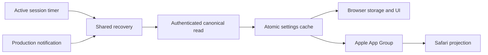
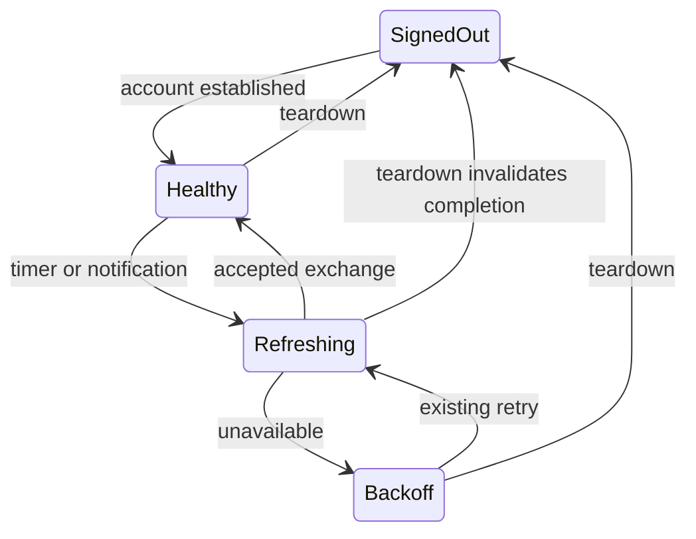
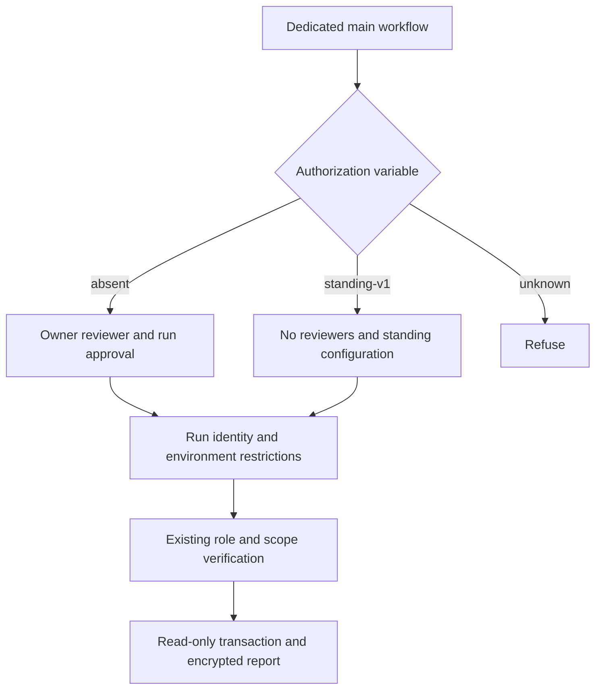

# Live settings convergence and scoped QA reads - Plan

## Goal Capsule

- Objective: Active signed-in devices receive one another's accepted settings changes without reopening the app. Authorized operators can perform the existing narrow QA database checks without approving every run once the owner activates standing authorization.
- Means: Periodic authenticated acquisition through the existing settings protocol (KTD1), and an explicit compatibility mode confined to the QA checker (KTD3).
- Authority: Product requirements below govern behavior; existing settings ownership and database access contracts remain authoritative.
- Execution: Autonomous implementation, verification, review, protected-branch delivery and successor compilation. The implementing agent owns those steps.
- Stop conditions: Owner activation of external environment settings and physical installation/retests remain owner gates. Neither is evidence that code implementation must wait.

---
## Product Contract

### Summary

Repair healthy-idle settings acquisition and prove isolation and recovery through actual backend/cache/service composition. Prepare narrowly scoped standing read-only QA authorization without changing production deployment protection.

### Problem Frame

The hosted QA backend deliberately refuses production profile subscriptions. SyncService currently relies on subscriptions or explicit recovery to acquire later changes. A successful startup read can therefore leave an active peer stale while its last successful exchange still reports Synced. Controlled QA evidence establishes an accepted server write and startup catch-up; it does not establish lost server merges or a production incident.

The QA database workflow requires per-run owner approval. Removing its reviewer alone makes its existing protection verifier fail, so standing authorization needs reviewed code and a coordinated owner configuration change.

### Requirements

| ID | Requirement |
| --- | --- |
| R1 | Active online modern clients acquire accepted per-field changes in both directions without a local edit, restart, or foreground transition. Measure observed latency without promising instant OS-background delivery. |
| R2 | Preserve versioned receipts, immutable pending operations, independent fields, local offline choices, and account/session ownership fences. |
| R3 | Failed acquisition uses bounded recovery; delayed responses, repeated sign-out/sign-in and worker recreation cannot reanimate a retired account. |
| R4 | QA acquisition exclusively uses its authenticated canonical route; no production profile subscription or coarse settings fallback. |
| R5 | Synced and Last synced remain statements about a successful account exchange, never peer agreement. Held authority and failed exchanges cannot establish success. No local-agreement banner is added. |
| R6 | Audit Chrome, Firefox desktop, Firefox Android, macOS app, iPhone app, Safari macOS and Safari iPhone, distinguishing source proof, controlled integration and physical verification. |
| R7 | Standing authorization applies only to the dedicated read-only QA workflow/environment on main with closed check/account inputs, the existing least-privilege SQL role, read-only rollback transactions and encrypted reports. |
| R8 | Default per-run approval remains supported. Standing mode requires explicit owner configuration; production deploy/payment/delete protections remain unchanged. |
| R9 | Reject wrong branch, workflow, environment, authorization mode, broader SQL privileges, unapproved scope and missing encryption. Record initiator and check scope without private identity data. |
| R10 | Preserve already merged fixes and truthful issue dispositions. Retain successor source hashes and build receipts; compilation is not installation or manual verification. |

### Acceptance Examples

- AE1. Covers R1/R2/R4: two independent clients using the QA backend port exchange successive same-field changes and simultaneous different-field changes while both remain open and receive no push notifications.
- AE2. Covers R2/R3/R5: an offline peer keeps a queued change; network restoration allows bounded upload and peer acquisition, without reset or false success during failure.
- AE3. Covers R3: an old read resolves after A → B → A; neither settings nor status from the retired session overwrite the current session.
- AE4. Covers R7/R8/R9: an explicitly configured standing run from the dedicated workflow on main can perform a catalogue check without run approval; absent authorization or a mismatched run fails before database access.

### Scope Boundaries

No settings protocol migration, hosted subscription publication, new cloud authority in Safari, analytics events, purchase changes or new host permissions. Background OS execution is not guaranteed. Existing unresolved visual/layout and live Facebook DOM evidence gaps retain their current dispositions. Android manual testing remains deferred. Do not reset owner settings or infer installation from a build receipt.

---
## Planning Contract

### Key Technical Decisions

- KTD1. For R1/R3, SyncService schedules one healthy refresh five seconds after the preceding attempt completes. Refresh shares existing in-flight work. Failed exchanges defer to the existing exponential retry scheduler; the healthy scheduler must not defeat backoff. Modern settings only; legacy behavior remains unchanged. This is an implementation cadence, not a network-latency SLO.
- KTD2. For R2/R4, refresh uses the existing authenticated canonical read and atomic acknowledgment/flush path. Keep the QA no-subscription guard. Session teardown cancels the periodic timer and fences its completion. Existing realtime remains a useful nudge where supported.
- KTD3. For R7/R8, keep one dedicated QA workflow/environment. Add an explicit repository variable selecting `standing-v1`; absence means per-run approval. In standing mode require no reviewer gate, disabled admin bypass and main-only branches. Validate run identity against GitHub and workflow context. Keep the production verifier unchanged.
- KTD4. For R9, retain the existing catalogue, role verifier, transaction and age-encryption code. Standing authorization does not bypass any database check or add SQL input. Fail closed on unknown authorization modes and unreadable GitHub protection.
- KTD5. For R6/R10, record surface-by-surface proof and owner retest requirements in private QA evidence; keep public code and documentation free of account identity, report plaintext and private screenshots.

### High-Level Technical Design

### Evidence and Constraints

`packages/core/src/sync/profile.ts` owns route selection and the deliberate QA subscription guard. `service.ts` owns recovery and lifecycle fencing. Follow `docs/solutions/logic-errors/invalidate-sync-work-by-session-lifecycle.md` and `recover-settings-uploads-without-losing-newer-edits.md`.

Chrome may suspend workers; a timer cannot promise execution while suspended ([Chrome lifecycle documentation](https://developer.chrome.com/docs/extensions/develop/concepts/service-workers/lifecycle)). Existing worker resume and host online/foreground paths must remain functional. Active-host composition and restart tests are required, not a timer-only unit test.

GitHub environment protections apply to jobs referencing that environment ([GitHub environment documentation](https://docs.github.com/en/actions/how-tos/deploy/configure-and-manage-deployments/control-deployments)). The workflow and runtime verifier must agree on mode, branch and environment before credentials are used.

---
## Implementation Units

### U1. Acquire modern settings while active

**Goal:** Close the idle receive gap. **Requirements:** R1–R5, AE1–AE3. **Dependencies:** none.

**Files:** `packages/core/src/sync/service.ts`, `packages/core/src/sync/__tests__/live-sync.test.ts`, existing atomic/recovery/lifecycle tests.

**Approach:** Add the timer to the existing session owner under KTD1/KTD2. Compose two real SupabaseBackendPort, SyncService, SettingsCache and AtomicSettingsWriter instances against controlled authenticated transport. Observe canonical versions, persisted records, subscription notifications and UI binding values independently.

**Execution note:** First reproduce missing idle convergence with the actual QA adapter; run the failing test before changing behavior.

**Patterns to follow:** Existing atomic-sync fixture protocol and lifecycle invalidation.

**Test scenarios:**
- Bidirectional and successive changes converge without external nudges; unrelated fields survive concurrent edits.
- Dropped notifications and delayed reads still catch up without parallel request storms.
- Offline upload persists and drains on recovery; failure does not report a new successful exchange.
- Teardown cancels timers; late completion cannot schedule work for a replacement account.
- Worker recreation restores persisted state and receives later changes.
- QA opens no production channel; production modern clients tolerate missing notifications.

**Verification:** Red-to-green composed regression plus existing sync, backend-route, storage, account lifecycle and mounted Apple host coverage.

### U2. Audit projection and mounted session lifecycle

**Goal:** Establish evidence across all seven surfaces. **Requirements:** R3/R5/R6/R10. **Dependencies:** U1.

**Files:** Relevant extension/app entrypoints, `packages/core/src/sync/apple-session.ts`, native settings bridge/store and existing lifecycle integration tests; `packages/core/src/storage/chrome-adapter.ts`, `packages/ext-safari/lib/__tests__/settings-storage.test.ts`; private audit document.

**Approach:** Trace actual wiring through CodeGraph and inspect surfaced current files. Exercise mounted host delayed cleanup and repeated auth cycles. The confirmed Safari subscription gap requires a completion-relative five-second native reread while the page is visible. Periodic reads do not overlap; a fresh storage-event signal supersedes a pending read so a delayed old-account response cannot block the latest native state. Unsubscribe cancels pending reads and timers. Native-mirror backgrounds and Chromium do not poll. Distinguish Safari's app-owned cloud session from its local projection.

**Execution note:** First reproduce app-originated native changes remaining stale in an open Safari cache without storage events.

**Test scenarios:** Safari acquires native changes without projection writes, skips hidden-page reads, recovers after errors, avoids overlapping periodic reads, supersedes obsolete reads on fresh signals and cancels pending reads/timers. Current same-account and A-to-B fences survive delayed cleanup/failure. Native bridge/store writes become observable to peer caches. Browser worker startup and popup recovery retain their acquisition path.

**Verification:** Seven named dispositions with source and test evidence; no fabricated device pass.

### U3. Support narrow standing QA read authorization

**Goal:** Make the dedicated checker compatible with the approved operating mode. **Requirements:** R7–R9, AE4. **Dependencies:** none.

**Files:** `scripts/backend/qa-checks/protection.mjs`, `qa-checks.test.mjs`, `.github/workflows/supabase-readonly-checks.yml`, `docs/release/qa-readonly-database-checks.md`.

**Approach:** Implement KTD3/KTD4 and document exact activation, dispatch/download/decrypt, audit and rollback steps. Owner changes the environment only after compatible code is merged and current-mode compatibility is verified.

**Execution note:** First prove the existing verifier rejects standing mode; add negative cases before implementation.

**Patterns to follow:** Existing dedicated guard tests and closed SQL catalogue. Do not generalize the production deployment checker.

**Test scenarios:** Default approval and explicit standing succeed only with the expected environment and run identity. Unknown mode, wrong workflow/branch/repository, bypass enabled, missing encryption and widened SQL role fail. No database write/deploy capability is added.

**Verification:** Node guard/workflow suite, Deno runner tests and existing disposable-database security CI. Current-mode hosted validation and representative standing run remain explicitly owner-gated if no approved run is available.

### U4. Verify and deliver successor

**Goal:** Supply reviewable code and a traceable successor candidate. **Requirements:** R6/R10. **Dependencies:** U1–U3.

**Files:** Solution/runbook documentation, private issue metadata, surface audit, package card and build receipts.

**Approach:** Review full diff, simplify only new code, run proportional full gates, merge through protected CI, compile six sandbox targets from the exact merged source and verify artifact hashes and native embedded resources.

**Test expectation:** Existing full gates and packaging verification; no additional unit behavior.

**Verification:** Green required CI, exact source receipt, retained candidate and explicit installation/activation/retest gates.

---
## Verification Contract

Run `pnpm lint`, `pnpm typecheck`, `pnpm test`, `pnpm build`, and `pnpm exec playwright test --project=fixtures`. Run relevant StillKit checks and QA checker Node/Deno tests. Required GitHub checks include security rehearsal. Targeted tests must fail against the pre-fix behavior and pass against the implementation. Record limitations of synthetic transport and physical-device evidence separately.

## Definition of Done

Implementation and review meet R1–R10 within agent authority, required CI passes, source is merged, successor artifacts are retained and verified, and private evidence records what remains owner-gated. U1 requires measured composed convergence; U2 requires all seven dispositions; U3 requires both modes tested and activation instructions; U4 requires exact-source packaging evidence. Remove abandoned experiments and preserve unrelated work. Standing authorization and physical fixes are not marked verified before their respective external observations.
